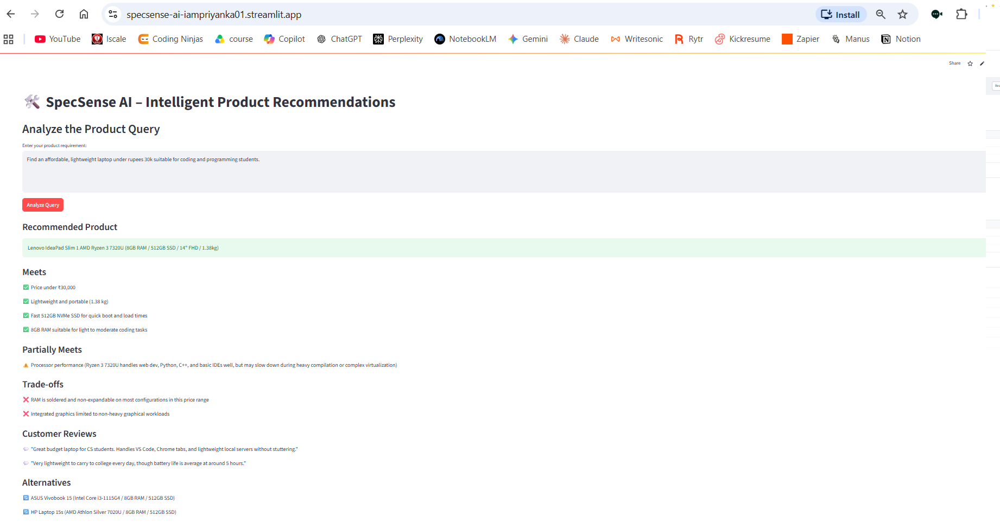

# 🔍 SpecSense AI — Intelligent Product Recommendations

SpecSense AI turns a **free-text shopping query** ("Need a lightweight laptop under ₹30k for coding and battery life") into an
**explainable recommendation**: what is met, what is only partly met, the trade-offs, a review snippet and alternatives.
It is a modular pipeline built with **Google Gemini**, **Streamlit** and prompt engineering (ReAct).

## Features
- **Single query analysis** — type a need, get a structured JSON recommendation.
- **Explainable output** — `meets`, `partially_meets`, `trade_offs`, `review_snippets`, `alternatives`.
- **Modular pipeline** — builder → executor → parser → `SpecSensor` orchestrator (same shape as ScamGuard).
- **Catalog grounding (`catalog_matcher.py`)** — matches against a *company catalog* (`data/products_sample.csv`) so products, specs and reviews are real rows, not model memory.

## Structure
```
specsense_ai/
├── main.py                      # command-line demo
├── config.py  utils.py          # settings, logger, JSON extraction
├── llm/client.py                # Gemini call with retry + back-off
├── llm/prompts.py               # loads the prompt template
├── llm/prompts/react.md         # ReAct prompt: Thought → Action → Observation → JSON
├── pipeline/spec_sensor/        # builder.py · executor.py · parser.py · sensor.py
├── catalog_matcher.py           # extract → match (pandas) → explain  (grounded version)
├── data/products_sample.csv     # 12 fictional laptops (replace with your own catalog)
└── streamlit/app.py             # browser UI
```

## Setup
```bash
python -m venv .venv && source .venv/bin/activate     # Windows: .venv\Scripts\activate
pip install -r requirements.txt
cp .env.example .env        # then edit .env and paste YOUR key (never commit it)
python main.py              # original pipeline
python catalog_matcher.py "Lightweight laptop under 30000 for coding"   # grounded version
streamlit run streamlit/app.py
```

## Known limitation of the original pipeline
`react.md` contains **no catalog**, so the model recommends from memory and may invent products, specs and "customer reviews".
Use `catalog_matcher.py` (or RAG) when answers must come from your own data. See the lesson page for a side-by-side demo.

## Demo

